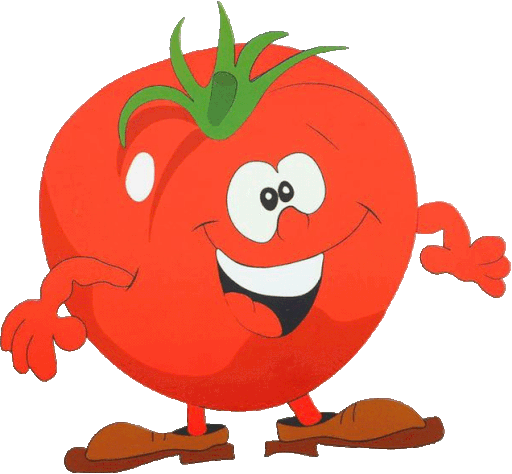

## Tomato: A Fruit, Vegetable, and the Plant That Conquered Dinner

Tomatoes have had an identity crisis for centuries. Botanically, they’re fruits. In the kitchen, they’re vegetables. And in **1893**, U.S. tariff law made it official: the Supreme Court ruled the tomato should be treated as a **vegetable** because that’s how people commonly use it. ([Justia Law][1])

<table>
  <tr>
    <td align="center">
        <h4>clodgraph Graph Extraction</h4>
        
    </td>
    <td align="center">
        <h4>clodgraph Phenotype Extraction</h4>
        
    </td>
  </tr>
</table>
<!--more-->

That single moment captures the bigger tomato story—how humans decide what a plant is, long before they understand what it’s made of.

If this sounds like a quirky trivia fact, it’s actually the perfect way to start a tomato anatomy blog—because tomato is not just a plant you study. It’s a plant that got shaped by language, fear, trade, taste, and science.

And the best part? The tomato didn’t conquer science first—it conquered dinner.

Fruit in botany, vegetable in real life

Let’s settle the “fruit vs vegetable” question in a way that doesn’t ruin the fun:

Botany calls tomato a fruit because it develops from a flower’s ovary and contains seeds.

Cooking calls tomato a vegetable because it behaves like one: savory, used in sauces, stews, salads, and main dishes.

Law (in that tariff case) followed the kitchen logic: “common language” beats technical definitions when you’re taxing imports.

So right from the beginning, tomato teaches a powerful lesson: plants live in two worlds—the biological world and the human world.

The science detective twist: why the tomato’s name changed

Now for the plot twist that confused generations of students.

Older books and older research papers often call tomato Lycopersicon esculentum. Modern sources usually call it Solanum lycopersicum.

That change happened because botanists kept re-checking the same question as science improved:

“Does tomato deserve its own genus (Lycopersicon), or is it truly part of the bigger Solanum group?”

Over time, evidence (especially genetics) supported grouping tomato with Solanum—the same broad genus that includes other well-known crops. Today, many authoritative databases and plant-biology references treat Solanum lycopersicum as the accepted scientific name, while Lycopersicon persists in older literature and legacy naming systems.

Blog-friendly translation:
Tomato didn’t change into a different plant. We just got better at placing it on the family tree.

The nightshade dogma: why people were afraid of tomatoes

When tomatoes reached Europe after the Columbian exchange, they arrived with a reputation they didn’t earn personally—they belonged to the nightshade family (Solanaceae).

Some nightshade relatives are genuinely toxic. So people made a leap that feels very human:

“Nightshades can be poisonous.”

“Tomato is a nightshade.”

“So tomato must be dangerous too.”

That fear became a cultural wall. Tomatoes were sometimes treated as ornamental curiosities instead of food—beautiful, suspicious, and “maybe not for eating.”

And to be fair: tomato plants do contain defensive chemicals. One of the most discussed is tomatine, a glycoalkaloid found at higher levels in green/unripe tissues (and generally lower as the fruit ripens). This is part of the plant’s natural defense system.

The key point:
Tomato wasn’t “deadly nightshade in disguise”—but the family connection created a dogma that took time (and a lot of cooking) to dissolve.

How tomato became a household staple: it won through recipes, not arguments

Tomato didn’t become famous because one scientist gave a speech proving it was safe.

Tomato became normal the way most foods become normal:

Someone cooks it successfully

It becomes part of a local recipe

People trust the recipe

The recipe spreads

The ingredient becomes “obvious,” almost invisible in daily life

This is why sauces matter so much. Tomato is easy to love when it’s been transformed into something warm, stable, and shareable: sauce, soup, stew, salsa, paste.

Once tomatoes moved from “a strange plant” to “the base of dinner,” they scaled into the ultimate kitchen ingredient—fresh, canned, dried, pureed, fermented, preserved.

In other words: tomato didn’t conquer the world by being a fruit.
It conquered the world by being useful.

The modern twist: tomato is also a nutrition powerhouse

Now we add the final reason tomato became a permanent resident of the household: it fits human health goals almost too well.

Tomatoes are:

low calorie and water-rich

a meaningful source of vitamin C and potassium

a source of folate and provitamin A carotenoids

famous for lycopene, the red carotenoid pigment linked to antioxidant activity

Using USDA FoodData Central-linked values for raw ripe tomatoes (per 100 g), you’ll commonly see numbers around:

Vitamin C: ~13.7 mg

Potassium: ~237 mg

Vitamin A: ~42 µg RAE

Folate: ~15 µg DFE

And here’s a kitchen-friendly bonus that’s perfect for your blog tone:

Cooking can change what your body absorbs.
Human studies have found that cooked tomato with olive oil can raise blood lycopene more than raw tomato alone—so traditional cooking didn’t just make tomato delicious, it likely made some compounds more bioavailable.

(Nutrition varies by variety and serving size—but the pattern is consistent: tomatoes deliver solid micronutrients plus carotenoids.)

---



[1]: https://supreme.justia.com/cases/federal/us/149/304/ "Nix v. Hedden | 149 U.S. 304 (1893)"
[2]: https://inspection.canada.ca/en/plant-health/plant-varieties/novel-traits/applicants/directive-94-08/biology-documents/solanum-lycopersicum "The biology of Solanum lycopersicum L. (tomato)"
[3]: https://www.sciencedirect.com/science/article/abs/pii/S0308814624005867 "Review on toxicology and activity of tomato glycoalkaloids"
[4]: https://www.logixpathchef.com/app/food/getfoodnutritionbyfdcid/170457 "Food Nutrition: Tomatoes, red, ripe, raw"
[5]: https://pubmed.ncbi.nlm.nih.gov/23478703/ "Influence of Cooking Procedure on Bioavailability"
